# NETWORKWALKS - Week 03 - Password Cracking with John the Ripper

- **Name:** Naduni Umeda
- **Batch:** B084
- **Module:** NETWORKWALKS - WK3

## Overview
- This project shows 2 ways to crack passwords
- Activity 01 - Kali Terminal + John the Ripper
- Activity 02 - Web Tools

---

## Activity 01 - Kali Terminal (PDF Password Cracking)

### Tools Used:
- Kali Linux
- pdf2john
- John the Ripper
- Google Drive + Firefox

### What I Did:
- First I tried to find the PDF file inside Kali, but I could not find it
- Then I uploaded the PDF from Windows to Google Drive
- Then I opened Firefox inside Kali and downloaded the PDF from Google Drive
- After that I could use pdf2john

### Steps:
- Used `pdf2john` to extract hash from PDF
- Saved hash to `hash.txt`
- Used John the Ripper with `rockyou.txt` wordlist
- Successfully cracked the PDF password

### Errors I Faced & How I Fixed:
- **Error 1:** PDF file not found in Kali
    - **Fix:** Uploaded PDF from Windows to Google Drive, then downloaded it in Kali using Firefox
- **Error 2:** `pdf2john` command error
    - **Fix:** Checked file path again and ran command with correct file name
- **Error 3:** John the Ripper did not start / wordlist not found
    - **Fix:** Used correct path for `rockyou.txt` and ran again

### Screenshots:

- Step 01 - pdf2john:
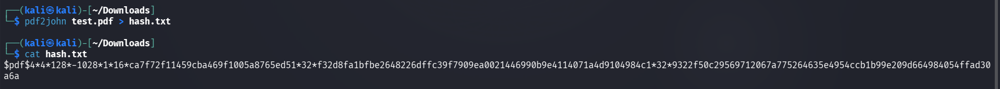

- Step 02 - Error:
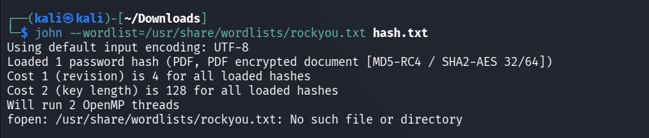
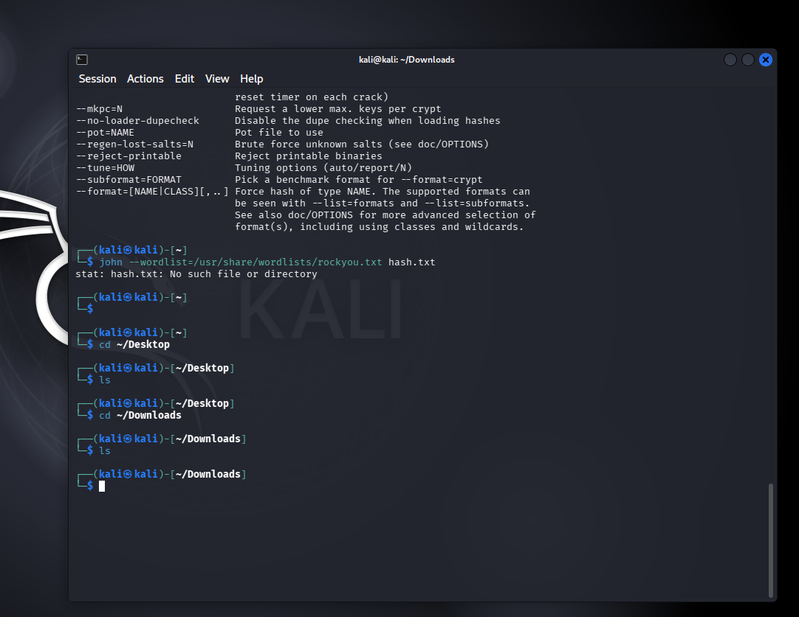

- Step 03 - Fix:
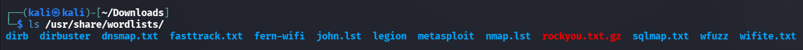
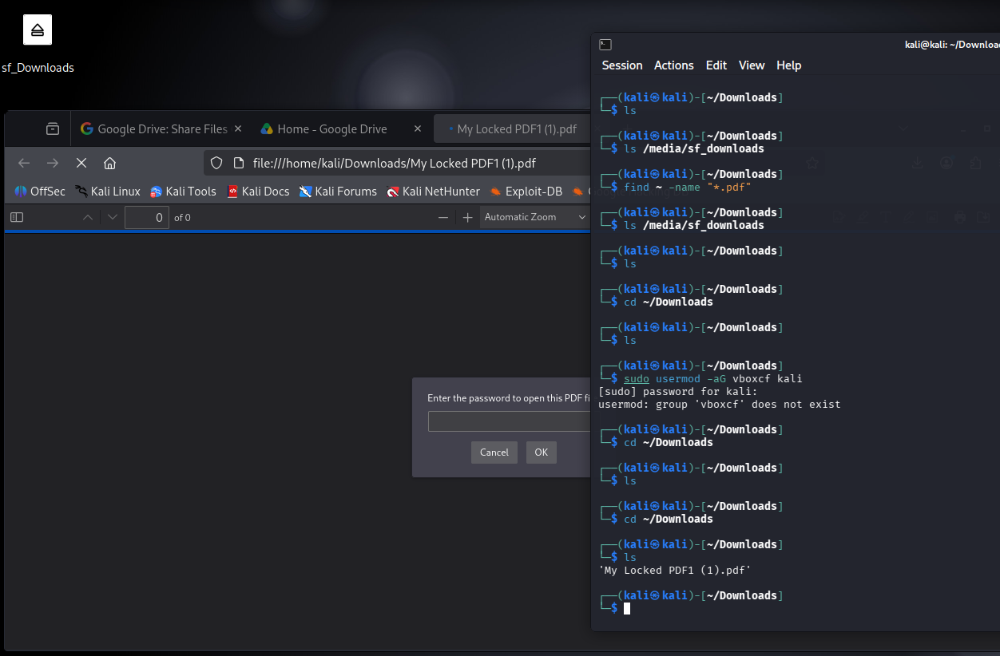

- Step 04 - Cracked:
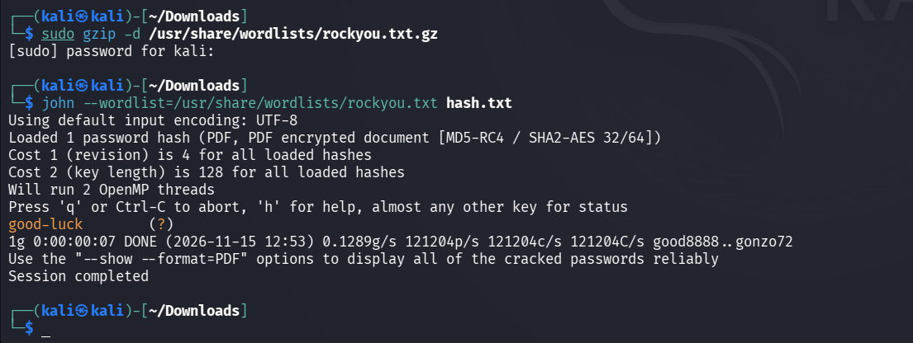

- Step 05 - Show Password:
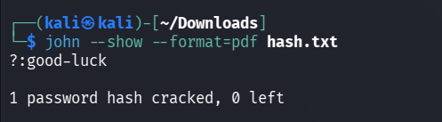

- Step 06 - Congratulations:
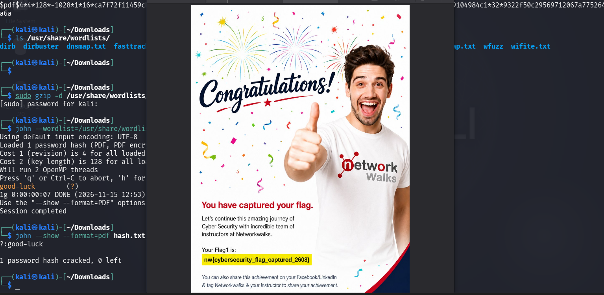

- Step 07 - Congratulations Full:

---

## Activity 02 - Web Tools (Hash Cracking)

### Tools Used:
- Online Hash Calculator
- Online Hash Cracker

### Steps:
- Calculated hash using Hash Calculator
- Pasted hash into Cracker tool
- Found the original password
- Entered password and got Congratulations + Flag

### Screenshots:

- Step 01 - Hash Calculator:
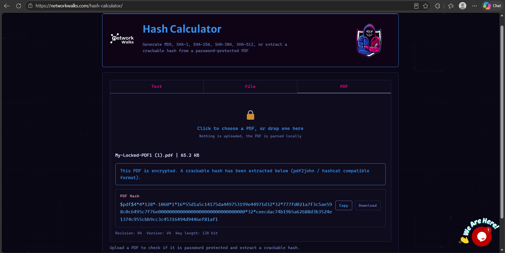

- Step 02 - Cracker:
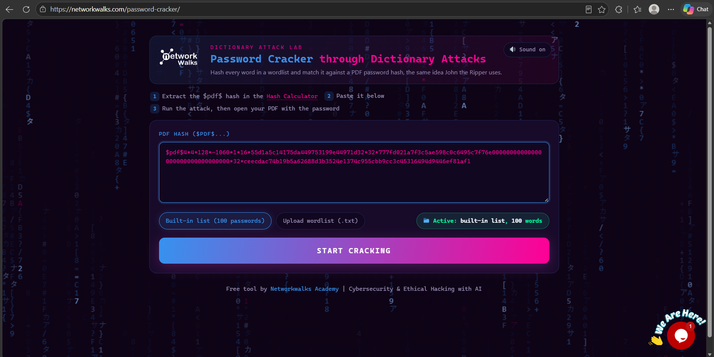

- Step 03 - Password Found:
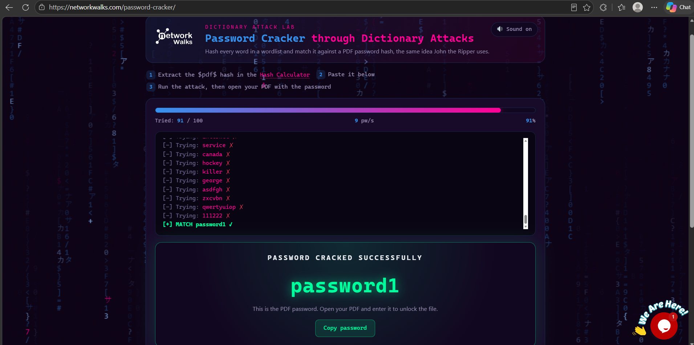

- Step 04 - Enter Password:
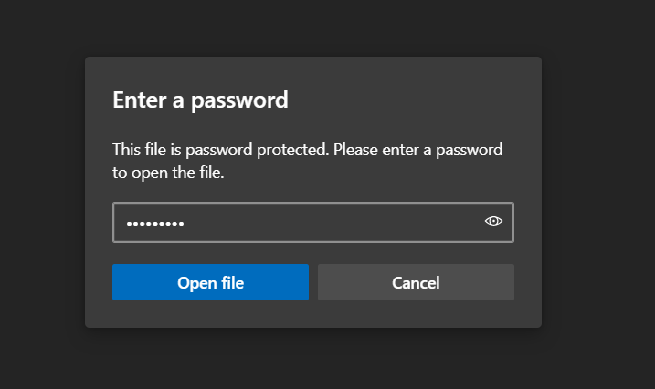

- Step 05 - Congratulations:

---

## Key Learning
- Weak passwords can be cracked easily with wordlist attacks
- PDF protection alone is not enough if password is weak
- Always use strong, unique passwords
- Troubleshooting is part of hacking - file path, tools, errors check karanna ona

## Repository Structure
- `activity-01-kali-terminal/` - Kali screenshots
- `activity-02-web-tools/` - Web screenshots + hash.txt
- `README.md` - This file
